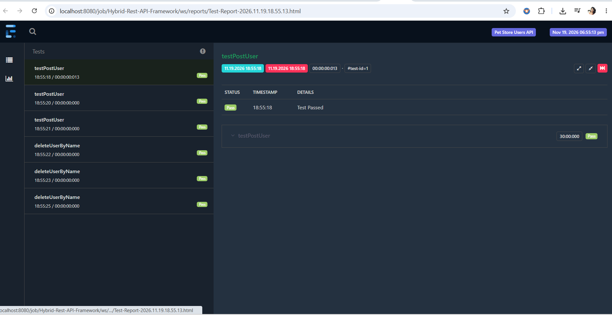

# Hybrid REST API Automation Framework

An enterprise-grade, data-driven **REST API Test Automation Framework** built with **Java**, **REST Assured**, **TestNG**, and **Gradle**. It covers end-to-end CRUD testing, JSON Schema contract validation, field-level response assertions, Excel data-driven execution, structured logging, interactive HTML reporting, and **Jenkins CI** integration.

---

## Tech Stack & Tools

* **Language:** Java (JDK 17 / 21)
* **API Testing & Validation:** REST Assured, JSON Schema Validator, JsonPath
* **Test Framework:** TestNG
* **Build & Dependency Management:** Gradle (with Gradle Wrapper)
* **Data-Driven Testing:** Apache POI (`.xlsx` Excel integration) & Java Faker / Datafaker
* **Reporting:** Extent Reports (`ExtentSparkReporter` via `ITestListener`)
* **Logging:** Log4j2 (Console & Rolling File Appenders)
* **CI/CD Integration:** Jenkins

---

## Project Architecture & Folder Structure

```text
Hybrid-Rest-API-Framework/
├── src/
│   └── test/
│       ├── java/
│       │   └── api/
│       │       ├── endpoint/       # CRUD request builders (UserEndPoints.java)
│       │       ├── payload/        # POJO models for serialization/deserialization (User.java)
│       │       ├── tests/          # TestNG test suites (DDTests.java, UserTests.java)
│       │       └── utilities/      # XLUtility, DataProviders, ExtentReportManager
│       └── resources/
│           ├── log4j2.xml          # Log4j2 console and rolling file configuration
│           ├── routes.properties   # Externalized API endpoint URLs
│           ├── testng.xml          # TestNG suite and listener configuration
│           └── user-schema.json    # JSON Schema contract for GET /user/{username}
├── testData/
│   └── Userdata.xlsx               # Excel dataset for data-driven test execution
├── screenshots/
│   └── extent-report.png           # Sample Extent Report generated via Jenkins CI
├── build.gradle                    # Gradle dependencies and TestNG runner configuration
└── gradlew / gradlew.bat           # Gradle Wrapper scripts
```

---

## Key Framework Features

* **Modular Layered Architecture:** Separates API endpoint builders (`UserEndPoints`), POJO data models (`User`), test classes (`DDTests`), and reusable utilities (`XLUtility`, `DataProviders`).
* **Contract & Field-Level Validation:** Validates response structures and data types using **JSON Schema Validator** (`matchesJsonSchemaInClasspath`), alongside **JsonPath** and **POJO deserialization** (`response.as(User.class)`) for business field assertions.
* **Dynamic Data-Driven Execution:** Reads multi-column Excel data via **Apache POI** and maps rows into `HashMap<String, String>` objects inside TestNG `@DataProvider` methods for clean, scalable test signatures.
* **Externalized Route Management:** Stores API endpoints in `routes.properties` loaded dynamically via Java's `ResourceBundle`.
* **Automated HTML Reporting:** Implements TestNG's `ITestListener` (`ExtentReportManager`) to generate timestamped, offline-enabled Extent Reports after each execution.
* **Structured Audit Logging:** Captures execution traces in both the console and `./logs/automation.log` using **Log4j2**.
* **Jenkins CI Integration:** Configured to execute automated regression runs via Gradle Wrapper (`./gradlew clean test`).

---

## How to Run Tests Locally

1. **Clone the repository:**
   ```bash
   git clone https://github.com
   cd Hybrid-Rest-API-Framework
   ```

2. **Run the test suite using Gradle Wrapper:**
    * **Windows:**
      ```cmd
      gradlew.bat clean test
      ```
    * **macOS / Linux:**
      ```bash
      ./gradlew clean test
      ```

3. **View Reports & Logs:**
    * **Extent Report:** Open the generated `.html` file inside the `reports/` folder in any browser.
    * **Execution Logs:** Open `logs/automation.log` to review detailed step-by-step logs.

---

## Sample Test Execution Report (Jenkins CI)


